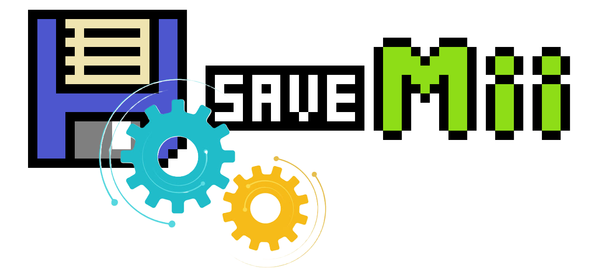

<p align="right">
<a href="https://github.com/w3irdv/savemii/#savemii-wut-port-processmod--savemymiis" title="SaveMii">Back</a>&nbsp&nbsp
<a href="https://github.com/w3irdv/savemii/#savemii-wut-port-processmod--savemymiis" title="SaveMii"></a>
<p align="right">


# SaveMii Batch Tasks

## Batch Backup

You can backup savedata for all Wii U titles and all Wii titles at once using this task. Savedata will be stored in a "Backup set" in the `batch` directory, and can afterwards be used to restore individual titles or to batch restore all of them.
BackupSets can be tagged by pressing the "+" button in the BackupSet List menu or by entering the Backupset Management menu from the Main menu.

```
sd:/wiiu/backups/batch/
    ${timestamp}/                  # batch backupSet
        SaveMiiMeta.json
        TitleName [xxxxxxxx-yyyyyyy]/          # one folder for each title
            0/                    # slot containing USB or NAND savedata for the title
                SaveMiiMeta.json
                80000001/
                    ...
                80000002/
                    ...
                ... one folder for each profile
                common/
                    ...
            1/                      # slot containing NAND savedata for titles simultaneously installed in USB and NAND
                 ...
        xxxxxxxxxyyyyyyyy/
            0/
            ...
```

### Backup All
This task will back up all initialized Wii U and vWii titles in a backup set. No exclude is applied.

### Backup Wii U / Backup vWii titles / Backup Wii U System titles
You can select the titles you want to back up. Press `Y` `<-` `->` to select or deselect titles. Press `+` `-` to select or deselect all titles.
Press `X` to access the "Backup Excludes" menu. There you can:

- Save currently unselected titles as "Backup Excludes."
- Apply saved "Backup Excludes", so that matching titles are deselected. You can also configure whether you always want to apply "Backup Excludes" in the "Options" menu.

The "Backup Excludes" option is useful if you have many titles that you don't usually play, so you don't need to back them up every time you perform a batch backup.


## Batch Restore

This task allows you to restore the savedata for all titles already installed in the Wii U or in the vWii from a batch backupSet,
1. Select whether you want to restore Wii U titles or vWii titles
2. Select the backupSet you want to restore from
3. Select which data to restore. Options are the same as in the *Restore* task. You can also choose if you want to perform a full backup (recommended) or to wipe data before restoring it.
4. The list of all titles that are installed, that have a backup in the backupSet, and that match the savedata criteria chosen in the previous step will appear. You can choose which ones to restore: Press `Y` `<-` `->` to select or deselect individual titles. Press `+` `-` to select or deselect all titles. Titles with "Not Init" will be skipped by default.

   **Note**: If you select `All users` and the backup contains savedata from a non-existent profile, a warning will appear: by default, SaveMii will not allow you to restore this backup (unless you disable this check in the Options menu, but this is discouraged). You can restore the backup using the option `From: select source user / To: select target user`. `To users` are always defined in the console.
5. Once you have reviewed the list of titles to be restored, press `A`. A summary screen will appear, and if it is OK, you can initiate the restore.
6. Once the restore is completed, a summary screen will show the number of success/failed/skipped titles.
7. The list of all titles will appear again, now showing the restored status. You can try to select failed titles and restore them again to see what the error is. Successfully restored titles will be skipped.


*Note*: You cannot batch restore system titles.

To restore the savedata from a batch backup, go to the individual system title restore menu and select the BatchBackupSet which contains the data you want to restore by pressing `X`. Then restore "as usual". 

## Batch Wipe

This task allows you to wipe savedata belonging to the selected list of titles.

1. Select which data to wipe: `Only common save`, `All users`, `From: select source user / To: select target user`. `common save: Yes/No`. You can also choose if you want to perform a full backup (recommended).
2. The list of all installed titles that match the savedata criteria chosen in the previous step will appear. You can select / deselect which titles to copy with `Y` `<-` and `->`, or select/deselect all at once with `+` and `-`. 
3. Once you have reviewed the list of titles to be wiped, press `A`. A summary screen will appear, and if it is OK, you can initiate the wipe.
4. Once the wipe is completed, a summary screen will show the number of success/failed/skipped titles.
5. The list of all titles will appear again, now showing the wipe status. You can try to select failed titles and wipe them again to see what the error is. Successfully wiped titles will be skipped.

   **Note**: Step 1 will detect savedata that is already stored in the console but that belongs to profiles that no longer exist. In these cases, you can choose to delete it (or ignore it). 


## Batch Move / Copy to Other Profile

This task allows you to move / copy savedata from one profile to a different profile for all titles already installed in the Wii U (or for some of them).

1. Select which data to restore: `From: select source user / To: select target user`. You can also choose if you want to perform a full backup (recommended) or to wipe data before restoring it.
2. The list of all installed titles that match the savedata criteria chosen in the previous step will appear. You can select / deselect which titles to move / copy with `Y` `<-` and `->`, or select/deselect all at once with `+` and `-`. 
3. Once you have reviewed the list of titles to be moved/copied, press `A`. A summary screen will appear, and if it is OK, you can initiate the operation.
4. Once the move/copy is completed, a summary screen will show the number of success/failed/skipped titles.
5. The list of all titles will appear again, now showing the copy status. You can try to select failed titles and move/copy them again to see what the error is. Successfully moved/copied titles will be skipped.

**Note**: Step 1 will detect savedata that is already stored in the console but that belongs to profiles that no longer exist. In these cases, you can  move it to an existent profile, or use Batch Wipe to delete it.


## Batch Copy to Other Device

This task allows you to move savedata between NAND and USB for titles that already have savedata in both media. 

1. Select if you want to move "From NAND to USB" or "From USB to NAND".
2. Select which data to restore: `Only common save`, `All users`, `From: select source user / To: select target user`. `common save: Yes/No`. You can also choose if you want to perform a full backup (recommended) or to wipe data before restoring it.
3. The list of all titles that are installed on both NAND and USB, and  that match  the savedata criteria you chose in the previous step will appear. You can select / deselect which titles to copy with `Y` `<-` and `->`, or select/deselect all at once with `+` and `-`. 
4. Once you have reviewed the list of titles to be restored, press `A`. A summary screen will appear, and if it is OK, you can initiate the copy.
5. Once the copy is completed, a summary screen will show the number of success/failed/skipped titles.
6. The list of all titles will appear again, now showing the copy status. You can try to select failed titles and restore them again to see what the error is. Successfully copied titles will be skipped.

   **Note**: Step 1 will detect savedata that is already stored in the console but that belongs to user profiles that are no longer defined. If you select the `All users` option, a warning will appear: by default, SaveMii will not allow you to restore this backup (unless you disable this check in the Options menu, but this is discouraged). You can copy the savedata using the option `From: select source user / To: select target user`. `To users` are always defined in the console, or delete it with Batch Wipe.   


## Backupset management

In this menu you can:
- tag backupsets (`+`)
- delete the ones you don't need (`-`)
- set the backupSet you want to use to restore savedata (`A`)
- show the content of the backupSet (`X`)

Choose `Set the default BackupSet (tasks will use it as their backup repo), tag it with a name, or wipe any backupSet` to manage backupSets, or `ExportSet (CEMU/Dolphin-ready): Convert / Contents / Tag / Wipe` to manage ExportSets.

The same operations can be performed on an ExportSet, except that an ExportSet cannot be used as the source to restore savedata. In this case, with `A` you can convert an ExportSet into a BackupSet. The ExportSet is not modified; a BackupSet is created from it. This new BackupSet can be used in Batch Restore or in individual restores. More information on ExportSet can be found [here](Emu_README.md)
