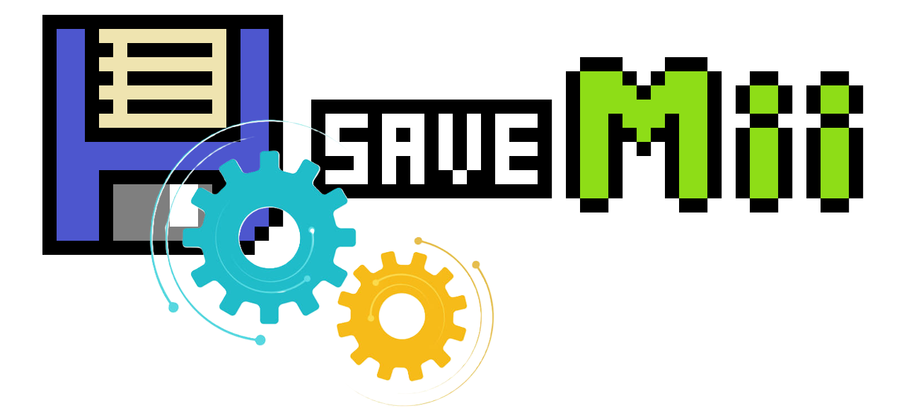

<p align="right">
<a href="https://github.com/w3irdv/savemii/#savemii-wut-port-processmod--savemymiis" title="SaveMii">Back</a>&nbsp&nbsp
<a href="https://github.com/w3irdv/savemii/#savemii-wut-port-processmod--savemymiis" title="SaveMii"></a>
<p align="right">


# Emulator Tasks

## Export saves using CEMU/Dolphin format

You can export savedata for several selected Wii U titles and Wii titles at once using this task. Savedata will be stored in an "Export Set" in the `batch\cemu_dolphin` directory in a layout that will allow you to copy it directly to your CEMU/Dolphin installation. ExportSets can be tagged by pressing the "+" button in the BackupSet List menu or by entering the Backupset Management menu from the Main menu.

```
sd:/wiiu/backups/cemu_dolphin/
    ${timestamp}/          # ExportSet
        SaveMiiMeta.json
        xxxxxxxx/          # high id (category identifier): WiiU: 00050000 (games), 00050010 (system), ... Wii: 00010000 (games)
            yyyyyyyy/      # low id: hexadecimal game identifier
                 ...       # savedata for vWii, meta and user folders with savedata for Wii U
            yyyyyyyy/      # low id for next game
                ...        # savedata
            ...
        xxxxxxxx/          # next highid
            yyyyyyyy/      # low id
                 ...       # savedata
            yyyyyyyy/
                ...        # savedata
            ...
```

You can take the full structure under `xxxxxxxx` and copy it to CEMU or Dolphin, or take the `yyyyyyyy` folder for one game and copy it. No title folder rename is needed, but in the case of Wii U, you might need to change the profile ID folder in `yyyyyyyy/user/${profileid}` so that it matches the one in your Cemu NAND. 

To create an ExportSet:

- From the main menu, select `Batch Tasks Management`. Then move to `Export in CEMU/Dolphin format`. Select the content you want to export: Wii U Titles, vWii Titles, or Wii U System Titles. The list of the selected titles will be shown. Press `Y` `<-` `->` to select or deselect titles. Press `+` `-` to select or deselect all titles. Press `A` to create the export.


## Convert an ExportSet into a BackupSet

You can copy the saves from the CEMU/Dolphin folders directly onto an SD card, under a folder inside `sd:/wiiu/backups/batch/cemu_dolphin/`. Use any name for the folder (it is not necessary to use the timestamp format).

```
sd:/wiiu/backups/cemu_dolphin/
    ${the_name_you_choose}/          # ExportSet
        xxxxxxxx/          # high id (category identifier): WiiU: 00050000 (games), 00050010 (system), ... Wii: 00010000 (games)
            yyyyyyyy/      # low id: hexadecimal game identifier
                 ...       # savedata for vWii, meta and user folders with savedata for Wii U
            yyyyyyyy/      # low id for next game
                ...        # savedata
            ...
        xxxxxxxx/          # next highid
            yyyyyyyy/      # low id
                 ...       # savedata
            yyyyyyyy/
                ...        # savedata
            ...
```

To use this ExportSet as a restore source, you must first convert it to a BackupSet.

- From the main menu, select `Batch Tasks Management`. Then move to `ExportSet (CEMU/Dolphin-ready): Convert / Contents / Tag / Wipe`. The list of ExportSets will appear. Move to the one you want to convert and press `A`. A new BackupSet will be created using the data from this ExportSet.
